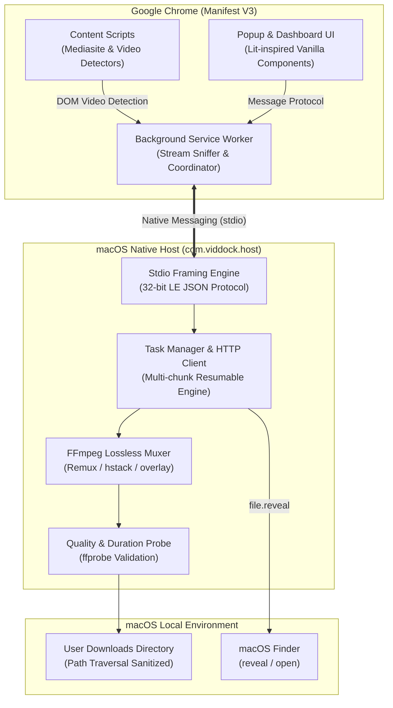

# VidDock

<div align="center">

**Your videos. Your device. No limits.**

_A 100% free, privacy-first, open-source Chrome extension and macOS companion host for high-fidelity media capture, lecture recording archiving, and lossless stream remuxing._

[](LICENSE)
[](#requirements)
[](apps/extension/manifest.json)
[](package.json)
[](https://ffmpeg.org)

[Quickstart](#quickstart) •
[Features](#features) •
[Architecture](#architecture-overview) •
[Mediasite Dual-Stream](#mediasite-dual-stream-capture) •
[Documentation](#documentation-index) •
[Security & Privacy](#privacy--security-model)

</div>

---

## Overview

**VidDock** is built to solve a modern web frustration: downloading online video content—especially multi-stream university lectures and fragmented HTTP adaptive streams—without paying for subscription downloader services, enduring cloud transcoding queues, or compromising your privacy.

Commercial downloader extensions often inject adware, cap download speeds, charge monthly subscriptions, or upload stream URLs to remote cloud infrastructure. VidDock is the antithesis:

- **100% Free & Open Source:** Licensed under the MIT License with zero paywalls, tiers, or artificial limits.
- **Privacy-First:** Zero telemetry, zero analytics, zero external dependencies at runtime, and zero accounts. All network traffic originates directly from your browser or native companion host to the media CDN.
- **Dual-Stream Mediasite Archiving:** Purpose-built engine for university lectures recorded via Mediasite, automatically capturing both the presenter camera feed and high-resolution presentation slides into synchronized Side-by-Side or Picture-in-Picture compositions.
- **Lossless Native Remuxing:** Powered by a local macOS native messaging host (`com.viddock.host`) driving local FFmpeg/ffprobe to assemble HLS transport streams and DASH segments without generational quality loss.

---

## Features

| Feature                   |             VidDock             |   Typical Browser Downloaders    |      Cloud SaaS Downloaders       |
| :------------------------ | :-----------------------------: | :------------------------------: | :-------------------------------: |
| **Pricing & Limits**      |    **100% Free, Unlimited**     | Free tier capped (e.g. 720p/1hr) | Monthly subscription ($10–$30/mo) |
| **Telemetry & Tracking**  |     **Zero (0 bytes sent)**     |  Common analytics & ad trackers  |   Full account & query logging    |
| **Cloud Processing**      |      **None (100% Local)**      |    Partial server offloading     |   100% cloud processed & stored   |
| **Mediasite Dual-Stream** | **Native (Side-by-Side & PiP)** | Unsupported (single stream only) |            Unsupported            |
| **HLS (RFC 8216) & DASH** |  **Master & media manifests**   |       Often behind paywall       |  Supported with file size limits  |
| **Lossless Remuxing**     |     **FFmpeg stream copy**      |    Re-encoding (quality loss)    |      Server-side transcoding      |
| **Manifest V3 Compliant** |   **Yes (declarative & SW)**    |   Struggling legacy extensions   |           N/A (Web UI)            |
| **Local File Management** |   **Reveal in macOS Finder**    |     Default Chrome Downloads     |      Manual browser download      |

---

## Architecture Overview

VidDock consists of two tightly integrated components:



1. **Chrome Extension (Manifest V3):** Sniffs network requests via declarative and runtime listeners, parses HLS (`.m3u8`) and DASH (`.mpd`) manifests in memory, extracts Mediasite metadata via internal JSON APIs, and coordinates downloads through a glassmorphism popup and dashboard.
2. **Native Companion Host (`com.viddock.host`):** A lightweight Node.js native messaging host registered with macOS Chromium browsers. Communicates over standard input/output using length-prefixed 32-bit JSON framing, streams chunks directly to disk, and delegates lossless packaging to local FFmpeg.

---

## Mediasite Dual-Stream Capture

Universities and educational institutions worldwide rely on Mediasite for capturing lectures. Mediasite broadcasts two simultaneous high-definition video feeds:

1. **Camera Feed:** Video of the professor, presenter, or chalkboard.
2. **Presentation Feed:** Real-time capture of presentation slides, digital whiteboards, or screencasts.

VidDock automatically detects dual-feed Mediasite presentations and provides three instant compositing options:

```
+-----------------------------------------------------------------------------+
|                               SIDE-BY-SIDE                                  |
|  +-----------------------------------+  +--------------------------------+  |
|  |                                   |  |                                |  |
|  |          Presenter Feed           |  |       Presentation Feed        |  |
|  |             (960x540)             |  |           (960x540)            |  |
|  |                                   |  |                                |  |
|  +-----------------------------------+  +--------------------------------+  |
|                                1920 x 540                                   |
+-----------------------------------------------------------------------------+
|                            PICTURE-IN-PICTURE                               |
|  +-----------------------------------------------------------------------+  |
|  |                                                                       |  |
|  |                       Presentation Slide Feed                         |  |
|  |                             (Full HD)                                 |  |
|  |                                         +--------------------------+  |  |
|  |                                         |   Presenter (1/3.5 scale)|  |  |
|  |                                         |  trunc(iw/2)*2 normalized|  |  |
|  |                                         +--------------------------+  |  |
|  +-----------------------------------------------------------------------+  |
+-----------------------------------------------------------------------------+
|                           SEPARATE VIDEO FILES                              |
|  [Lecture-Camera.mp4] (Full HD)       [Lecture-Slides.mp4] (Full HD)         |
+-----------------------------------------------------------------------------+
```

---

## Supported Formats & Protocols

- **HLS (HTTP Live Streaming, RFC 8216):** Master playlists, media playlists, variant bitrate selection (1080p, 720p, 480p, audio-only), AES-128 segment decryption, and byte-range addressing (`#EXT-X-BYTERANGE`).
- **MPEG-DASH (ISO/IEC 23009-1):** Static and dynamic MPD manifests, multi-Period parsing, `SegmentTemplate` (with `$Number$` and `$Time$`), `SegmentList`, and separate audio/video representation merging.
- **Mediasite Presentations:** Automatic conversion of Microsoft Smooth Streaming (`.ism/manifest`) to Apple HLS (`(format=m3u8-aapl)`), slide image timelines, and dual-camera video feeds.
- **Direct HTTP Media:** Progressive MP4, WebM, M4V, MOV, MKV, MP3, AAC, FLAC, and OGG streams.
- **Lossless Containers:** Automated container selection matching stream codecs without re-encoding (MP4 for H.264/AAC, WebM for VP9/Opus, MKV for complex or multi-track media).

---

## Quickstart

### Prerequisites

- **macOS:** Tested on macOS 12 (Monterey), 13 (Ventura), 14 (Sonoma), and 15 (Sequoia) on Apple Silicon (M1/M2/M3/M4) and Intel.
- **Google Chrome** (or Chromium, Brave, Microsoft Edge).
- **Node.js >= 20.0.0** (Install via [Homebrew](https://brew.sh): `brew install node`).
- **FFmpeg & ffprobe** (Install via [Homebrew](https://brew.sh): `brew install ffmpeg`).

### 1. Download Release Bundle

Download the latest release zip archives from [greenLemin/VidDock Releases](https://github.com/greenLemin/VidDock/releases):

- `VidDock-v1.0.0-chrome.zip`: Chrome extension bundle.
- `VidDock-v1.0.0-macos-installer.zip`: Native companion installer bundle.

Or build from source:

```bash
git clone https://github.com/greenLemin/VidDock.git
cd VidDock
npm install
npm run build
```

### 2. Install the Chrome Extension

1. Open Google Chrome and navigate to `chrome://extensions/`.
2. Enable the **Developer mode** toggle in the top-right corner.
3. Click **Load unpacked**.
4. Select the `VidDock/apps/extension/dist` directory (or unzipped `VidDock-v1.0.0-chrome` folder).
5. Note the 32-letter **Extension ID** generated by Chrome (e.g., `pknljchblnkgfmfcfdfkddedjofmjbkj`).

### 3. Register the Native Companion Host

Run the macOS installer script:

```bash
./scripts/install-macos.sh
```

_Tip: If installing for a specific extension ID or multiple browsers (Brave, Edge, Canary):_

```bash
./scripts/install-macos.sh --extension-id <YOUR_EXTENSION_ID> --all-browsers
```

### 4. Verify Your Setup

Verify that all dependencies, manifests, and stdio communication channels are functioning:

```bash
./scripts/verify-installation.sh
```

A complete verification displays green checkmarks for Node.js, FFmpeg, ffprobe, native host manifest registration, and a live stdio handshake test.

---

## User Interface Overview

VidDock features a clean, macOS-native glassmorphism user interface:

- **Browser Action Badge:** Displays the number of active video streams detected on the current tab. Turns vibrant violet/indigo when Mediasite dual-stream lectures are active.
- **Quick Popup (`popup/index.html`):** Lists detected video streams with resolution badges (e.g. `1080p`, `720p`), estimated file size, audio bitrates, and a single-click download trigger. For Mediasite, displays the stream layout selector.
- **Download Dashboard (`dashboard/index.html`):** Real-time monitoring of all active, queued, and completed downloads. Shows instant download speeds, percentage completion, byte counters, ETA, pause/resume/cancel controls, and a **"Reveal in Finder"** button.
- **Preferences (`settings/index.html`):** Configures default download folder, concurrent download limits (1–8), preferred media container (Auto / MP4 / MKV), and custom filename naming templates (`{title} - {quality} ({date})`).

---

## Documentation Index

Comprehensive technical documentation is located in the [`docs/`](docs/) directory:

- [**Architecture & Protocol**](docs/ARCHITECTURE.md): Deep dive into MV3 Service Worker lifecycle, WebRequest sniffers, 32-bit binary stdio framing, and the FFmpeg remuxing pipeline.
- [**Installation Guide**](docs/INSTALLATION.md): Detailed walkthrough for unpacked extension loading, companion script options, and multi-browser support.
- [**User Guide**](docs/USER_GUIDE.md): End-to-end instructions for capturing streams, configuring quality, and managing downloads.
- [**Mediasite Architecture Guide**](docs/MEDIASITE.md): In-depth guide to Mediasite APIs, dual-stream detection, side-by-side vs PiP layout math, and cookie handling.
- [**Development & Testing**](docs/DEVELOPMENT.md): Guide for contributors, covering npm workspaces, Vitest unit/integration testing, and synthetic stream E2E tests.
- [**Troubleshooting & FAQ**](docs/TROUBLESHOOTING.md): Solutions for native host disconnection, PATH issues, FFmpeg missing, and permission errors.
- [**Supported Formats & Codecs**](docs/SUPPORTED_FORMATS.md): Detailed compatibility matrix for HLS, DASH, MP4, WebM, and audio stream combinations.
- [**Security & Threat Model**](docs/SECURITY.md): Threat vectors, path traversal prevention, command injection defense, and sandbox boundaries.
- [**Limitations & Non-Goals**](docs/LIMITATIONS.md): Transparent explanation of DRM restrictions (Widevine/FairPlay/PlayReady), live stream scope, and browser boundaries.

---

## Privacy & Security Model

VidDock is designed according to strict privacy and local-first computing principles:

1. **No External Network Calls:** The extension and native host make HTTP requests _exclusively_ to media stream endpoints requested by the user. There are no telemetry pings, crash reporting endpoints, or remote feature-flag servers.
2. **Strict Native Messaging Boundary:** The native host (`com.viddock.host`) communicates strictly over standard input/output (`stdio`). It rejects requests from any Chrome extension origin other than the explicitly whitelisted ID in `com.viddock.host.json`.
3. **Path Traversal Containment:** Output paths and filenames are aggressively sanitized (`sanitizeFilename`), resolving real canonical filesystem paths to guarantee downloads remain strictly within user-designated directories inside `~` (`$HOME`). NUL bytes, `..` traversals, and symlink escapes are rejected with `PathError`.
4. **Command Injection Immunity:** All external processes (`ffmpeg`, `ffprobe`, `open`) are spawned using Node.js `execFile` with explicit argument vectors. Shell invocation (`child_process.exec` or `sh -c`) is strictly forbidden throughout the codebase.
5. **DRM Compliance:** VidDock does not crack, decrypt, or bypass DRM systems (Google Widevine, Apple FairPlay, Microsoft PlayReady, ClearKey). Encrypted streams are flagged and skipped.

---

## Contributing

We welcome contributions from developers, researchers, and students!

- Read our [Contributing Guidelines](CONTRIBUTING.md) for branch conventions, coding standards, and testing expectations.
- Adhere to our [Code of Conduct](CODE_OF_CONDUCT.md).
- To report security vulnerabilities, review our [Security Policy](SECURITY.md).

Run all validation checks before submitting a Pull Request:

```bash
npm run verify
```

---

## Release Verification

Release artifacts are cryptographically hashed and published in `SHA256SUMS.txt`:

```bash
# Verify download integrity
shasum -a 256 -c release/SHA256SUMS.txt
```

---

## License

VidDock is licensed under the [MIT License](LICENSE).  
Copyright (c) 2026 Jake / greenLemin.
