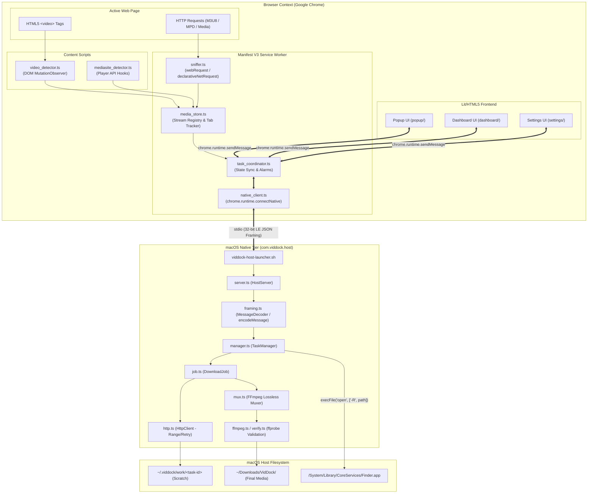
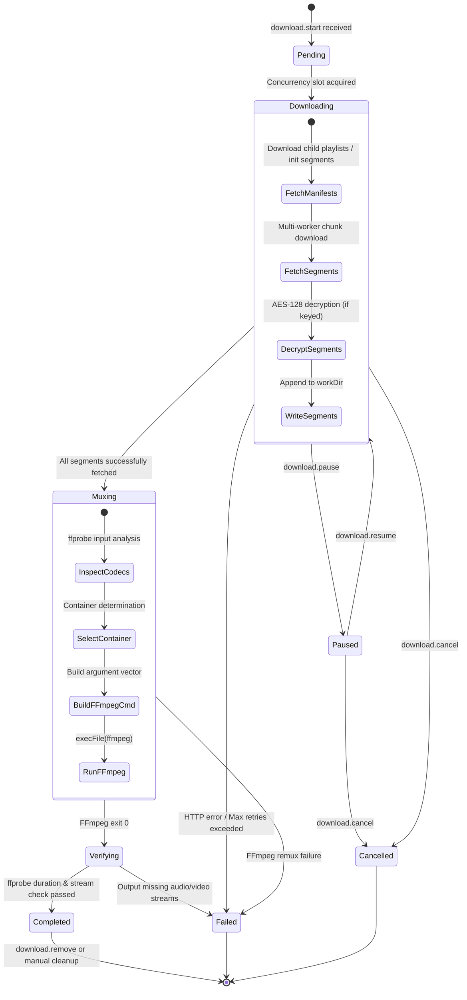

# VidDock System Architecture

This document provides an exhaustive technical overview of the VidDock architecture, detailing communication protocols, the Manifest V3 service worker lifecycle, network sniffing mechanics, the stdio native messaging framing protocol, the FFmpeg lossless remuxing pipeline, and download state machines.

---

## 1. High-Level System Overview

VidDock is split into two distinct execution tiers:

1. **Chrome Extension (Manifest V3):** Executes within the browser sandbox. Sniffs network traffic, interacts with web page DOMs, parses streaming manifests, and provides the user interface.
2. **Native Companion Host (`com.viddock.host`):** Executes in the local macOS user space as an independent Node.js process managed by Chrome. Performs concurrent byte-range HTTP segment downloads, file I/O, FFmpeg remuxing, probe verification, and system Finder integration.



---

## 2. Manifest V3 Service Worker & Sniffing Engine

### 2.1 Service Worker Lifecycle & Keep-Alives

Manifest V3 replaces background pages with ephemeral service workers. Chrome may terminate an idle service worker after 30 seconds of inactivity. VidDock handles this constraint cleanly:

1. **Native Port Keep-Alive:** While an active native messaging port (`chrome.runtime.connectNative('com.viddock.host')`) is held open, Chrome maintains the service worker lifecycle.
2. **Alarm Fallback:** A `chrome.alarms` periodic heartbeat runs every 60 seconds during active downloads to wake the service worker, poll task state if disconnected, and update extension badge counters.
3. **Decoupled Architecture:** Crucially, long-running download tasks, chunk assembly, and FFmpeg remuxing reside inside the **native companion process**, completely immune to browser service worker terminations. If the service worker sleeps, active downloads proceed uninterrupted in the background host.

### 2.2 Stream Sniffing Engine (`sniffer.ts`)

VidDock detects media through a dual-strategy sniffing pipeline:

1. **Network Header Interception:**
   Using `chrome.webRequest.onSendHeaders` and `chrome.webRequest.onHeadersReceived`, VidDock intercepts outbound requests and inbound responses across web pages:
   - Evaluates URL extensions: `.m3u8`, `.mpd`, `.mp4`, `.webm`, `.m4v`, `.m4a`, `.ism/manifest`.
   - Inspects `Content-Type` response headers: `application/vnd.apple.mpegurl`, `application/x-mpegurl`, `application/dash+xml`, `video/mp4`, `video/webm`.
   - Captures contextual headers: `Referer`, `Origin`, `User-Agent`, and cookies required to replay authorized HTTP requests during download.

2. **DOM Video Element Detection (`video_detector.ts`):**
   Content scripts injected into top-level frames and iframes observe HTML5 `<video>` and `<source>` DOM elements using `MutationObserver`. When a page dynamically sets a media `src`, blob URL, or MSE (Media Source Extensions) attachment, the detector captures the element's resolution (`videoWidth` x `videoHeight`) and reports it to `media_store.ts`.

---

## 3. Stdio Native Messaging Protocol

The Chrome browser and the native companion host (`com.viddock.host`) communicate over standard input (`stdin`) and standard output (`stdout`).

### 3.1 32-bit Binary Framing Specification

Messages are framed according to Chrome's native messaging specification:

- Each message begins with a **4-byte unsigned 32-bit integer** indicating the byte length of the following JSON payload.
- The length is encoded in the host's **native byte order** (Little-Endian on macOS Apple Silicon and Intel):

```
+---------------------------+-----------------------------------------------+
|  Length Header (4 bytes)  |             JSON Payload (N bytes)            |
|       uint32_t (LE)       |                  UTF-8 JSON                   |
+---------------------------+-----------------------------------------------+
```

- **Maximum Incoming Size (Extension -> Host):** VidDock enforces an upper safety limit of 64 MiB (`MAX_INCOMING = 64 * 1024 * 1024`).
- **Maximum Outgoing Size (Host -> Extension):** Chrome enforces a hard ceiling of 1 MiB (`MAX_OUTGOING = 1024 * 1024 - 1024`). The native host breaks large diagnostics and task lists into chunked updates.

### 3.2 Protocol Messages & Request Flow

All communication follows an asynchronous request-response pattern identified by a unique `id` string, supplemented by unprompted `task.update` events:

#### Request Types (Extension -> Host)

- `hello`: Handshake probe. Requests host version, platform, default download directory, and detected FFmpeg/ffprobe paths.
- `download.start`: Submits a fully parsed download job (`NativeDownloadRequest`) specifying media tracks, segment URLs, headers, output filename, and composition layout.
- `download.pause` / `download.resume` / `download.cancel` / `download.remove`: Controls execution of a specific task by `taskId`.
- `tasks.list`: Retrieves an array of all active and historical download jobs.
- `file.reveal` / `file.open`: Instructs the host to reveal the downloaded file in macOS Finder or open it in the default system media player.
- `config`: Configures host runtime parameters, such as `maxSimultaneous` parallel downloads.

#### Host Messages (Host -> Extension)

- `reply`: Sent in direct response to a request (`ok: true` with `data`, or `ok: false` with `error` and `code`).
- `task.update`: Unprompted event emitted whenever a task changes status, advances downloaded byte counts, updates segment counters, or completes muxing.

---

## 4. Download Engine & Task Lifecycle

The native host implements a resilient multi-stage download manager:



### 4.1 Download Stages

1. **Pending:** The job is queued in `TaskManager`. When active tasks drop below `maxSimultaneous`, the job transitions to `Downloading`.
2. **Downloading:**
   - Multi-connection HTTP client fetches media segments with automatic exponential backoff retry.
   - Byte-range headers (`Range: bytes=start-end`) are used for DASH single-file representations.
   - Segments are saved inside an isolated scratch directory: `~/.viddock/work/<task-id>/`.
3. **Muxing:**
   - When all segments are assembled, `mux.ts` analyzes stream codecs using `ffprobe`.
   - FFmpeg remuxes inputs into the target output container.
4. **Verifying:**
   - `verify.ts` runs `ffprobe` on the final output file, ensuring valid duration, audio/video stream presence, and reasonable audio-video sync.
5. **Completed:**
   - The file is atomically moved to the user's output directory (`~/Downloads/VidDock/`). Scratch directories are deleted.

---

## 5. Lossless Remuxing & Filter Pipeline (`mux.ts`)

VidDock emphasizes **lossless stream copying** whenever possible, avoiding re-encoding to preserve 100% of the original video quality and execute exports in seconds.

### 5.1 Container Selection Logic (`chooseContainer`)

| Primary Video Codec  | Primary Audio Codec |    Selected Container     |          Mux Mode           | Notes                                |
| :------------------- | :------------------ | :-----------------------: | :-------------------------: | :----------------------------------- |
| H.264 (AVC)          | AAC / MP3           |          `.mp4`           |   Direct copy (`-c copy`)   | Standard Apple & Web compatibility   |
| HEVC (H.265)         | AAC                 |          `.mp4`           | Direct copy (`-tag:v hvc1`) | Tagged for Apple QuickTime / iOS     |
| VP9 / AV1            | Opus / Vorbis       |          `.webm`          |   Direct copy (`-c copy`)   | Open web standard                    |
| Mixed / Incompatible | Incompatible        |          `.mkv`           |   Direct copy (`-c copy`)   | Matroska container without transcode |
| Audio Only           | AAC / ALAC          |          `.m4a`           |   Direct copy (`-c copy`)   | Native Apple audio                   |
| Audio Only           | MP3 / FLAC / Opus   | `.mp3` / `.flac` / `.ogg` |   Direct copy (`-c copy`)   | Lossless audio container             |

### 5.2 Mediasite Dual-Stream Compositions

When a Mediasite presentation contains dual video streams (e.g. Presenter Camera + Slide Deck), FFmpeg executes hardware-accelerated composition filters:

#### Side-by-Side (`hstack`) Composition:

Scales both video streams to identical 960x540 dimensions with aspect-ratio preserving padding, stacking them horizontally into a 1920x540 canvas:

```bash
ffmpeg -hide_banner -nostdin -y \
  -i camera.mp4 -i screen.mp4 \
  -filter_complex "[0:v:0]scale=960:540:force_original_aspect_ratio=decrease,pad=960:540:(ow-iw)/2:(oh-ih)/2,setsar=1[left];\
                   [1:v:0]scale=960:540:force_original_aspect_ratio=decrease,pad=960:540:(ow-iw)/2:(oh-ih)/2,setsar=1[right];\
                   [left][right]hstack=inputs=2[v]" \
  -map "[v]" -map 0:a? \
  -c:v libx264 -preset fast -crf 22 -pix_fmt yuv420p \
  -c:a copy output.mp4
```

#### Picture-in-Picture (`overlay`) Composition:

Places the presentation slide feed as the full-screen canvas and overlays the presenter camera in the bottom-right corner at 1/3.5 scale with 24px margins.

Notice the dimension normalization filter `trunc(iw/2)*2:trunc(ih/2)*2`:

```bash
ffmpeg -hide_banner -nostdin -y \
  -i camera.mp4 -i screen.mp4 \
  -filter_complex "[1:v:0]scale=iw/3.5:-2,setsar=1[pip];\
                   [0:v:0]scale=trunc(iw/2)*2:trunc(ih/2)*2,setsar=1[main];\
                   [main][pip]overlay=W-w-24:H-h-24[v]" \
  -map "[v]" -map 0:a? \
  -c:v libx264 -preset fast -crf 22 -pix_fmt yuv420p \
  -c:a copy output.mp4
```

> [!NOTE]
> `trunc(iw/2)*2` prevents odd-pixel width/height errors during H.264 encoding with 4:2:0 chroma subsampling.
